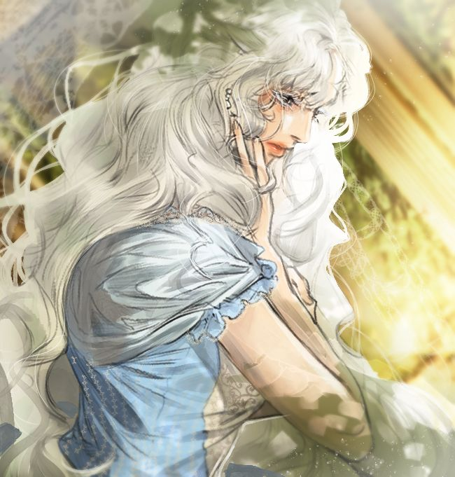

<!DOCTYPE html>
<html lang="en">

<head>
    <meta charset="UTF-8">
    <meta name="viewport" content="width=device-width, initial-scale=1.0">

    <title>Rashta - The Villainess</title>

    <!-- Connects the external CSS file -->
    <link rel="stylesheet" href="style.css">
</head>

<body>

    <!-- SIDEBAR -->

    

        <a href="javascript:void(0)"
           class="closebtn"
           onclick="closeNav()">&times;</a>

        <a href="#">General</a>
        <a href="#">Manhwa</a>
        <a href="#">Kdrama</a>
        <a href="#">Light Novel</a>

    

<!-- MAIN CONTENT BOX -->
<main class="main-container">

   <header>
    <!-- SIDEBAR BUTTON -->
    
        ♡
    

    <!-- CART BADGE -->
    

        🛒 Cart: 0
    

    <h1>RASHTA</h1>
    
The Empress

</header>

    <!-- CHARACTER INFORMATION AND IMAGE -->

    <section class="character-container fade-in">

        <fieldset class="character-info">

            <legend>Character Information</legend>

            
<strong>Name:</strong> Rashta

            
<strong>Title:</strong> Slave Empress

            
<strong>Occupation:</strong> Former Empress

        </fieldset>

        

            

        

    </section>

<!-- SUPPORT NOTIFICATION -->

    ♡ Rashta love has been shared! ♡

<!-- NOTIFICATION SOUND -->

<audio id="notificationSound"
       src="noti.mp3"
       preload="auto">
</audio>

<!-- GALLERY CATEGORY SELECTOR -->

<section class="gallery-selector fade-in">

    <h2>Choose Rashta's Collection</h2>

    

        <button class="category-button active"
                onclick="selectGallery('general')">
            General
        </button>

        <button class="category-button"
                onclick="selectGallery('manhwa')">
            Manhwa
        </button>

        <button class="category-button"
                onclick="selectGallery('lightNovel')">
            Light Novel
        </button>

    

</section>

<!-- RASHTA GALLERY -->

<section class="gallery fade-in">

    <h2 style="text-align: center;">
        Rashta's Gallery
    </h2>

    

        <button class="carousel-arrow left"
                onclick="previousImage()">
            &#10094;
        </button>

        

        

        <button class="carousel-arrow right"
                onclick="nextImage()">
            &#10095;
        </button>

    

       <!-- RASHTA DESCRIPTION -->
    

        

            The late slave empress. May she rest in peace in our hearts.
        

    

</section>

<!-- QUANTITY SELECTOR -->

    Quantity:

    <button class="quantity-button" onclick="changeQuantity(-1)">−</button>

    1

    <button class="quantity-button" onclick="changeQuantity(1)">+</button>

<!-- RASHTA SUPPORT BUTTON -->

<section class="support-section fade-in">

    <button class="support-button" onclick="supportRashta()">
        ♡ Support Rashta ♡
    </button>

</section>
<!-- PROMO CODE -->

    <input type="text" id="promoInput" placeholder="Enter promo code (try WINNER)" style="padding: 8px; width: 60%; border: 2px solid #c9889a; border-radius: 10px 0 0 10px; outline: none;">
    <button onclick="applyPromo()" style="padding: 8px 12px; background: #612234; color: white; border: 2px solid #612234; border-radius: 0 10px 10px 0; cursor: pointer; font-weight: bold;">Apply</button>
    

</main>

<!-- JAVASCRIPT -->

</body>
</html>
